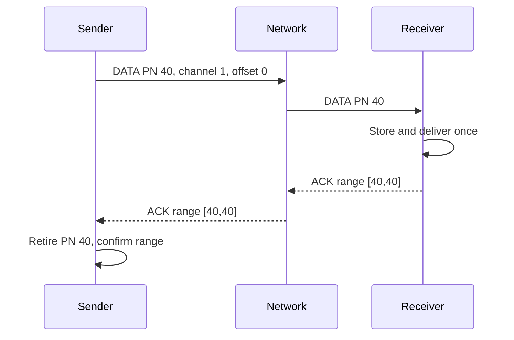
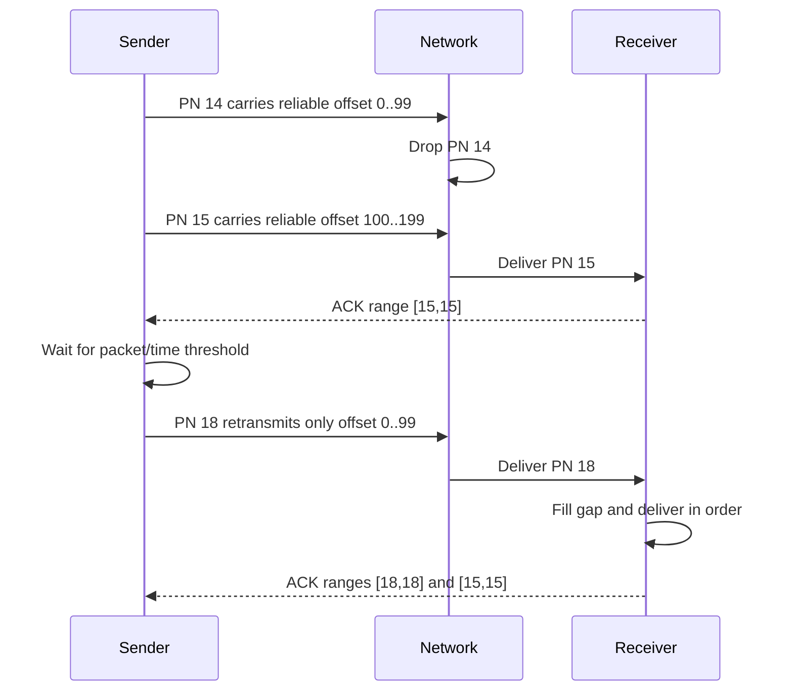
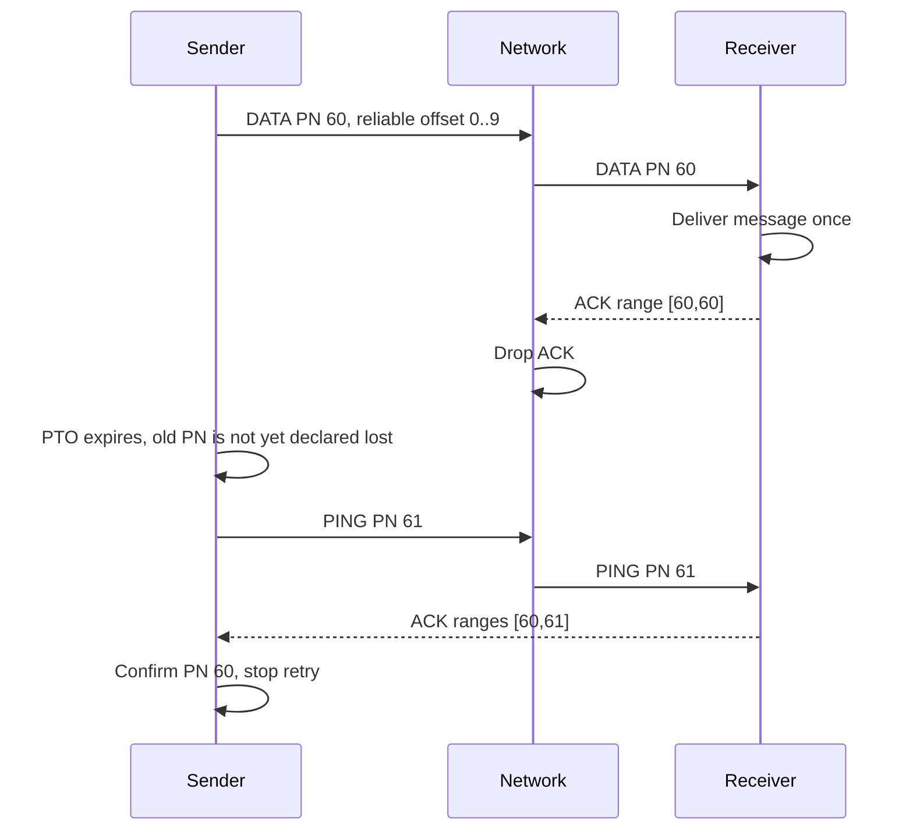
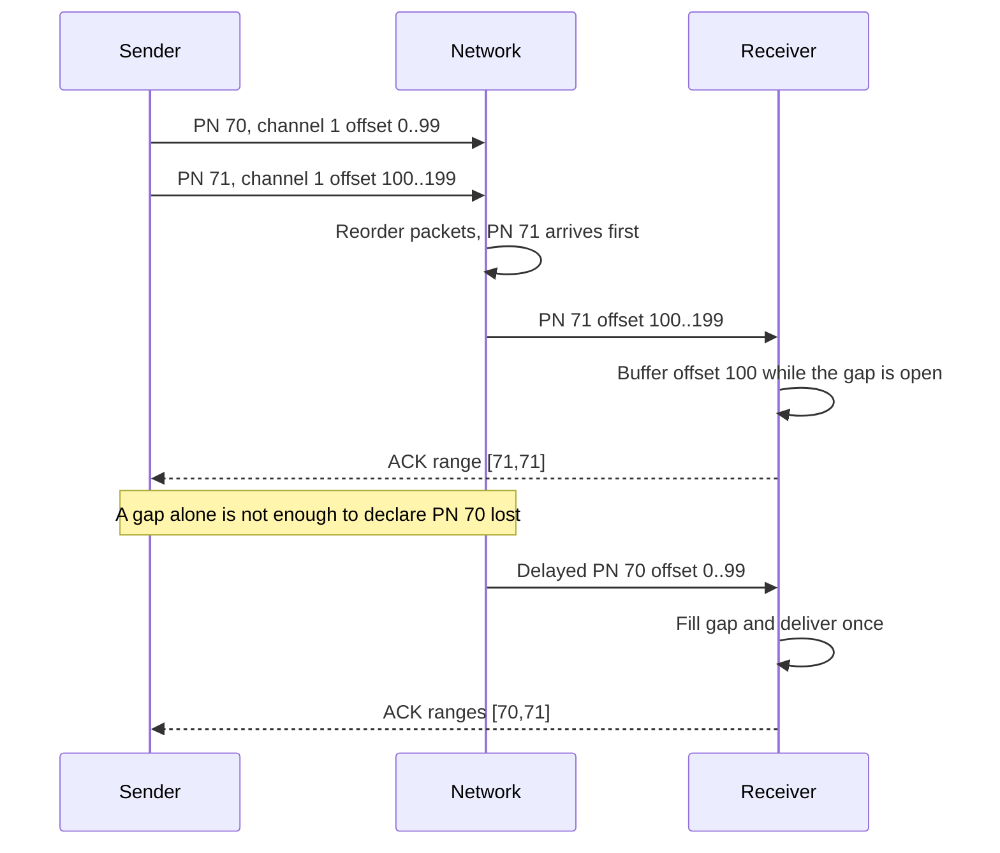
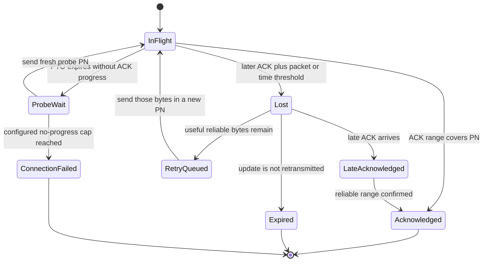

# Reliability design - Lab 2 draft

**Status:** AI_DRAFT_COMPLETE; TECHNICAL_REVIEW_PENDING; TEAM_DECISION_PENDING.  
**Classification:** PROPOSED group design, not a course-mandated protocol, student-approved decision, implementation, or test result.  
**Tentative owners:** REL-01 Nguyễn Đăng Gia Đạo; REL-02 Nguyễn Đổng Thiên Kỳ. Both names and assignments remain TENTATIVE until the students confirm.

## 1. Problem and scope

The proposed streaming session carries two kinds of application data:

1. **Reliable ordered data:** setup, configuration, and commands that must reach the receiver completely and in order within their channel.
2. **Expiring real-time updates:** game or media state for which a later update is often more useful than retransmitting an old one.

The goal is to recover useful reliable data after loss, avoid delivering retransmitted content twice, and keep receiver memory bounded. This is an explainable Selective Repeat-like application design using packet ACK ranges and reliable stream offsets. It is not QUIC, and the course has not required QUIC or implementation of this algorithm.

Lab 2 source emails require draft designs for Reliability, Flow Control, and Congestion Control. They give Steam UDP and Google QUIC as examples. They do not prescribe these packet fields, thresholds, or algorithms. Assignment 1 statements about TCP, UDP, file transfer, and head-of-line blocking remain separate unresolved requirements in [the requirements matrix](requirements-matrix.md).

## 2. Baseline decisions

| Concern | Proposed baseline | Why |
|---|---|---|
| Packet identity | Monotonic packet number per sending direction; a fresh number for every transmitted packet | Separates packet receipt/loss from the identity of the carried data |
| Reliable data identity | Channel ID plus byte stream offset and length; frame boundaries identify complete messages | A retransmission can move the same byte range into a new packet |
| ACK | ACK ranges for received ack-eliciting packet numbers | Reports packet receipt and lets the sender see gaps without treating every gap as loss |
| Loss | Declare an earlier outstanding packet lost only after a later ACK and either a packet threshold or time threshold | Allows ordinary reordering; starting thresholds are borrowed from RFC 9002 as teaching references |
| Timeout | PTO sends a fresh probe; a PTO by itself does not mark earlier packets lost | Recovers tail loss and lost ACKs without treating silence as proof of loss |
| Retransmission | Retransmit only outstanding reliable byte ranges in a new packet number | Avoids replaying an entire old packet or sending already-confirmed bytes |
| Duplicate handling | Packet-number duplicate filter plus per-channel range reassembly | Distinguishes a duplicate packet from the same content carried in a new packet |
| Real-time state | Never retransmit a lost update; drop stale queued updates and older sequence numbers | Preserves freshness and avoids making newer state wait for an old update |
| Ordering | In order within each reliable channel; unrelated channels and real-time state may progress independently | Limits, but does not eliminate, head-of-line blocking |
| Resource limits | Receiver out-of-order ranges count against the Flow Control credit and local buffer cap | Prevents reliability from creating unbounded receiver memory use |

## 3. Names that must not be confused

- **Packet number (PN):** identifies one transmission attempt in one direction. Retransmission uses a new PN.
- **Stream offset:** identifies a byte position in one reliable channel. The same offset can appear in a later packet if its earlier transmission is unacknowledged.
- **Message boundary / message ID:** framing identifies where a complete application message begins and ends. An optional command ID can support application idempotency, but it is not a packet number.
- **Update sequence:** identifies the freshness order of real-time updates in an application channel. It is neither a PN nor a reliable stream offset.
- **Packet ACK:** reports that the receiver accepted a packet at the transport layer. It does not prove that the application committed a command or completed a side effect. If the application needs that guarantee, it needs an application-level response or transaction rule.

A repeated PN is a duplicate packet and must not be parsed or delivered again. A reliable range repeated under a different PN is not a duplicate packet; it is a retransmission of the same content and is deduplicated by channel and offset. Re-sending the same command intentionally at a new offset is a new command.

## 4. Proposed packet and frame fields

This is a conceptual format only. Exact widths, encoding, checksums, maximum datagram size, and compatibility rules are undecided.

| Field | Required when | Purpose |
|---|---|---|
| connection_id | Every packet | Selects the current session |
| packet_number | Every numbered packet | Identifies this transmission in the sender's direction |
| type / flags | Every packet | Identifies data, ACK, probe, or close behavior; includes whether receipt is ack-eliciting |
| ACK frame | When acknowledging received packets | Largest acknowledged PN, descending inclusive ranges, and measured ACK delay |
| receive-credit frame | When advertising or repeating credit | Absolute connection and optional channel limits for new reliable byte offsets |
| reliable-data frame | Reliable content | Channel ID, stream offset, byte length, message boundary information, and payload |
| real-time frame | Expiring update | Channel ID, update sequence, optional freshness metadata, and payload |
| close / error frame | On termination | Reports a connection failure or orderly close |

Each direction has its own PN counter; an ACK range always refers to the peer's packets in that direction. ACK-only packets also get a fresh PN, but are not ack-eliciting in the baseline, to avoid an ACK-of-ACK loop. Their congestion-budget treatment is left for the Congestion Control pair to confirm. Data and probe packets are ack-eliciting. A data packet can carry an ACK frame as well as payload.

### ACK range policy

An ACK frame contains the largest received ack-eliciting PN and zero or more older inclusive ranges, newest first. For example, ranges [105,106] and [101,102] report that 101, 102, 105, and 106 were received; the missing values 103 and 104 are not thereby declared lost. The receiver keeps a bounded set of recent ranges and a monotonic minimum acceptable PN. If old ranges must be discarded to cap memory or packet size, later retransmission may be needed; packets below the minimum acceptable PN are rejected rather than re-accepted.

The receiver sends an ACK promptly when a new packet reveals a PN gap or arrives out of order. Otherwise, the baseline sends an ACK after two ack-eliciting packets or after the configured maximum ACK delay, whichever comes first. The two-packet trigger is a simple reference to RFC 9000 guidance; the actual delay must be agreed and measured. Pure ACK packets do not elicit more ACKs. A later ACK can repeat older ranges, so loss of an ACK does not erase the receiver's record.

## 5. Sender and receiver state

### Sender state

| State | Kept for | Exit condition |
|---|---|---|
| `next_packet_number` | Next transmission in this direction | Increment once when a packet is sent; do not reuse or wrap within a connection |
| `sent_packets[PN]` | Send time, wire bytes, ack-eliciting flag, congestion-accounted flag, reliable ranges carried, and packet state | Retain until ACK/loss accounting is complete and late-ACK handling is no longer needed |
| `reliable_ranges[channel]` | New and outstanding byte ranges, message framing, and whether any transmission copy was ACKed | Remove a range after its copy is ACKed; fail or cancel only under an agreed application rule |
| `latest_rtt`, `smoothed_rtt`, `rttvar` | RTT sampling and loss/PTO timers | Update from eligible ACK samples; initial estimator is a configurable reference value |
| `largest_acked` | Highest valid packet number acknowledged by the peer | Monotonically increase |
| `bytes_in_flight` | Congestion-controlled packets not yet ACKed or declared lost | Add/subtract each packet's accounted bytes once |
| `pto_count`, `loss_time` | Probe backoff and next time-threshold check | Reset the PTO backoff on new ACK progress; recompute after send/ACK/loss |
| `update_queue` | Fresh, unsent real-time snapshots with sequence and local usefulness limit | Drop expired or superseded items |

### Receiver state

| State | Kept for | Exit / bound |
|---|---|---|
| `received_packet_ranges` | Recently accepted ack-eliciting PNs for ACK generation | Bounded by ACK size policy and minimum acceptable PN |
| `seen_packet_numbers` | Duplicate suppression for accepted packets | Bounded by the same recent-PN window |
| `next_delivery_offset[channel]` | First byte not yet delivered on each ordered reliable channel | Advance only when all prior bytes and a complete message frame are present |
| `reorder_ranges[channel]` | Received reliable bytes above the first missing offset | Count against receive credit and local buffer cap |
| `delivered_message_state[channel]` | Framing and already-delivered command/message position | Retain enough state for in-connection duplicate suppression |
| `latest_update_sequence[channel]` | Freshness of the most recent delivered update | Reject older or equal sequences |
| `receive_credit` | Absolute maximum offsets the sender may consume | Increase only when application consumption actually frees capacity |

PN history, stream ranges, and application side effects are different state. The transport can prevent a retransmitted range from being delivered twice in one live session. It cannot promise exactly-once side effects across a process crash, lost session state, or reconnect; use an application command ID and idempotent operation if that is required.

## 6. End-to-end lifecycle

1. The application creates a reliable framed message on a channel or a fresh real-time update.
2. The sender assigns reliable bytes a stream offset. A retransmission keeps that offset; a new command gets a new offset.
3. Before sending new reliable bytes, the sender respects the receiver's absolute credit. Before sending any congestion-controlled packet, it also respects the shared Congestion Control budget and pacing.
4. The sender assigns the outgoing packet a fresh PN and records send time, wire size, carried ranges, and ACK/loss state.
5. The receiver validates the connection and PN. An already-seen PN is not processed again, but an ACK for it may be repeated.
6. The receiver buffers in-credit reliable ranges, removes already-held overlaps, and delivers only complete messages beginning at the next contiguous offset for that channel. Out-of-order bytes use receive credit.
7. The receiver accepts only a fresh real-time sequence. It drops an older sequence or an update expired under the agreed freshness rule.
8. The receiver sends an ACK range for received ack-eliciting PNs, immediately on a gap or according to the ACK policy above.
9. The sender validates ACK ranges, updates packet state, RTT, bytes-in-flight, and reliable byte-range status, then runs loss detection.
10. If useful reliable ranges remain, the sender retransmits only those ranges in a fresh PN. A real-time update is not retransmitted after loss. Repeated PTO with no ACK progress eventually reports connection failure.

## 7. Loss detection and retry parameters

### A later packet is evidence, not proof by itself

The sender examines only earlier ack-eliciting packets still outstanding when a newly received ACK advances `largest_acked`. The proposed starting rules are:

1. **Packet threshold:** declare the earlier packet lost after ACK ranges confirm three distinct higher-numbered ack-eliciting packets. Count ACKed packet entries, not raw PN distance.
2. **Time threshold:** once a later packet is acknowledged, declare the earlier packet lost when its age reaches `max(9/8 * max(smoothed_rtt, latest_rtt), 1 ms)`.

RFC 9002 recommends 3 as its initial packet reordering threshold, along with a 9/8 time multiplier and 1 ms timer granularity. This draft borrows those starting values but adapts the packet trigger: it counts three later ACKed ack-eliciting packets instead of using raw PN distance. RFC 9002 packet-number-distance detection assumes no sender-induced gaps; this draft assigns PNs to ACK-only packets that do not elicit ACKs, so counting ACKed packets avoids treating those numbers as loss evidence. These are technical references for a teaching baseline, not CO3094 requirements or proof of QUIC compatibility. A reordering-heavy path can still cause spurious loss; a later ACK for a packet already marked lost is accepted as a late ACK and can cancel a queued retransmission.

In this baseline, assigned reliable control ranges stay useful until ACK or connection failure. The sender cannot silently abandon an assigned byte offset because that would leave an ordered-stream gap. Application cancellation after assigning an offset needs an explicit reset/cancel rule, which is outside this draft.

### PTO probes for progress

The startup values used below are technical references: RFC 9002 Appendix A.2 recommends an initial RTT of 333 ms, and RFC 9000 Section 18.2 uses a default maximum ACK delay of 25 ms when none is communicated. Neither value is required by CO3094.

When ack-eliciting traffic has no ACK progress, compute the proposed application-data probe timeout as:

```text
PTO = smoothed_rtt + max(4 * rttvar, timer_granularity) + max_ack_delay
```

For startup, the draft uses the RFC 9002 initial RTT reference of 333 ms and initializes `rttvar` to half of that until a sample arrives. The draft uses a 1 ms timer granularity and the RFC 9000 default `max_ack_delay` of 25 ms unless the peers negotiate another value. These are borrowed reference defaults, not instructor requirements. If an illustrative measured RTT is `smoothed_rtt = 80 ms`, `rttvar = 10 ms`, and `max_ack_delay = 25 ms`, then `PTO = 80 + max(40, 1) + 25 = 145 ms`. This arithmetic is an example, not a claim about the course VM or expected network.

On each consecutive PTO expiry, double the wait period. Send one congestion-controlled, ack-eliciting probe under a new PN. It can carry the oldest still-useful reliable range; if there is no such data, send a small PING/probe. A PTO alone does not mark earlier packets lost and does not itself constitute a Congestion Control loss event. Reset the backoff when a newly ACKed ack-eliciting packet provides progress.

For a bounded teaching example, this draft proposes at most **five PTO probe attempts without ACK progress**. If all five probes fail to produce progress by the following PTO expiry, report connection failure. Five is an application-policy assumption for discussion, not an RFC recommendation or a CO3094 value. The pair must choose or replace it based on application tolerance and tests. The implementation would also cap the total no-progress duration to avoid waiting forever if timer behavior changes.

### Loss and in-flight accounting

- On first send of a congestion-controlled ack-eliciting packet, add its wire bytes to `bytes_in_flight`.
- On its first ACK or first loss declaration, remove those bytes exactly once.
- A late ACK for a packet already declared lost does not subtract its bytes again. It can still confirm the carried reliable ranges and cancel an unsent retry.
- If a retransmission has already been sent, track its new PN and bytes independently until that packet is ACKed or lost.
- Report packet ACKs, confirmed loss events, RTT samples, PTO probes, retransmitted ranges, and `bytes_in_flight` changes to Congestion Control. Do not report a PTO expiry as confirmed loss.
- The Congestion Control pair decides whether and how a pure ACK-only packet uses the path budget. Reliability rate-limits ACK generation and never retransmits old ACK frames.

## 8. Pseudocode

### Sender: process an ACK and detect loss

```text
on_ack(ack, now):
    if ack.connection_id != this_connection:
        discard
    if any acked PN is greater than largest_packet_number_sent:
        reject ACK as invalid

    newly_acked = []
    for pn in ack.ranges:
        packet = sent_packets.get(pn)
        if packet is absent:
            continue
        if packet.state == IN_FLIGHT:
            packet.state = ACKED
            if packet.congestion_accounted:
                bytes_in_flight -= packet.wire_bytes
                packet.congestion_accounted = false
            newly_acked.append(packet)
            mark_each_carried_reliable_range_confirmed(pn)
        else if packet.state == LOST:
            packet.state = LATE_ACKED
            mark_each_carried_reliable_range_confirmed(pn)
            cancel_matching_retry_if_not_yet_sent(pn)
            report_spurious_loss_signal_to_congestion_pair(pn)
        else:
            continue

    sample_RTT_from_one_eligible_newly_acked_packet(ack.ack_delay, now)
    largest_acked = max(largest_acked, ack.largest_acked)

    for packet in older_in_flight_packets_below(largest_acked):
        if count_later_acked_ack_eliciting_packets(packet.PN) >= 3
           or age(packet, now) >= max(9/8 * max(smoothed_rtt, latest_rtt), 1 ms):
            packet.state = LOST
            subtract_its_congestion_bytes_once(packet)
            report_confirmed_loss(packet)
            for range in packet.reliable_ranges:
                if range_is_not_confirmed(range) and range_is_still_useful(range):
                    queue_range_for_retransmission(range)
            discard_lost_expiring_updates_without_retransmitting_them(packet)

    if newly_acked contains ACK-eliciting progress:
        pto_count = 0
    recompute_loss_time_PTO_and_send_eligibility()
```

The time threshold is evaluated only after a later packet has been acknowledged. A PN gap alone is not a loss declaration.

### Sender: PTO and retransmission

```text
on_PTO_expiry():
    if no_ack_eliciting_packet_is_outstanding:
        return
    if probes_without_ack_progress == 5:
        notify_application_connection_failed()
        stop_sending_on_this_connection()
        return

    probe = oldest_unconfirmed_reliable_range_that_is_still_useful()
    if probe exists:
        send(probe, fresh_packet_number, congestion_controlled=true)
    else:
        send_small_PING(fresh_packet_number, congestion_controlled=true)

    probes_without_ack_progress += 1
    next_PTO_period *= 2
    do_not_mark_previous_packets_lost()
```

The cap of five is the teaching assumption stated above. It is a discussion default only.

### Receiver: packet processing and ACK generation

```text
on_packet(packet):
    if packet.connection_id != this_connection:
        discard
    if packet.PN < minimum_acceptable_PN:
        discard_as_too_old
    if packet.PN in seen_packet_numbers:
        if packet.is_ack_eliciting:
            schedule_ACK_including_recent_ranges()
        return

    record_packet_number(packet.PN)
    if packet.is_ack_eliciting:
        add_packet_to_received_ACK_ranges(packet.PN)

    for frame in packet.frames:
        if frame is reliable data:
            validate_channel_offset_length_and_receive_credit(frame)
            store_only_missing_byte_ranges_within_buffer_cap(frame)
            deliver_complete_messages_in_order_from(next_delivery_offset[channel])
        else if frame is expiring real-time update:
            if frame.sequence <= latest_update_sequence[channel]:
                discard_as_duplicate_or_stale
            else if update_is_expired_under_agreed_clock_rule(frame):
                discard_as_expired
            else:
                latest_update_sequence[channel] = frame.sequence
                deliver_update(frame)
        else:
            process_control_frame_idempotently(frame)

    if packet_is_gap_or_out_of_order(packet.PN):
        send_ACK_promptly()
    else if ack_eliciting_packet_count >= 2 or ACK_delay_timer_expired:
        send_ACK_with_bounded_recent_ranges()
```

Only complete reliable messages at the next contiguous offset are exposed to the application. Credit is advanced only when application consumption frees buffer capacity.

## 9. Diagrams

### Diagram 1: normal data and ACK



### Diagram 2: packet loss and selective retransmission



### Diagram 3: ACK lost after data arrived



### Diagram 4: out-of-order reliable data



### Loss and recovery state



## 10. Worked examples

### Example A: a gap does not mean immediate loss

The sender transmitted ack-eliciting PNs 14, 15, and 16. The receiver ACKs 15 and 16, but PN 14 is absent. Only two later ack-eliciting packets have been ACKed, so the packet threshold of three is not met. The sender waits for the time threshold or further ACK progress. If PN 17 is later ACKed, three later ack-eliciting packets are now confirmed; PN 14 can be declared lost. The sender retransmits its still-unconfirmed reliable range in a new PN, subject to flow and congestion budgets.

### Example B: a lost ACK need not cause a duplicate command

PN 60 contains a complete command at reliable channel 1, offsets 0 through 9. The receiver stores and delivers it once, then sends ACK [60,60]; the ACK is lost. The sender has no progress and reaches PTO, so it sends a fresh PING at PN 61. The receiver ACKs [60,61]. The sender retires PN 60 and does not retransmit the command. If a data copy had been retransmitted before that ACK arrived, the receiver would ignore the already-held byte range and still deliver the framed command only once.

### Example C: out-of-order delivery and channel-level HoL

PN 70 carries bytes 0 through 99 on channel 1; PN 71 carries bytes 100 through 199. PN 71 arrives first and is ACKed as received. The receiver buffers it within the advertised credit but cannot deliver the ordered channel-1 stream past the missing 0 through 99. A separate channel can continue, and a fresh real-time update can still be delivered. When PN 70 arrives or its bytes are retransmitted under a fresh PN, the receiver fills the gap and delivers channel 1 in order.

### Example D: late ACK after a spurious loss declaration

The sender declares PN 80 lost after the configured threshold and queues its reliable range. Before the retry is sent, an ACK for PN 80 arrives. The sender marks the packet late-acknowledged, confirms the range, and cancels that queued retry. It does not subtract PN 80's bytes from `bytes_in_flight` a second time. If the retry had already been sent as PN 85, PN 85 remains independently tracked until its own ACK or loss event.

### Example E: an update becomes stale

The application queues update sequence 22, then sequence 23. If 22 expires locally before send, it is dropped. If 23 is already delivered and 22 later arrives, the receiver drops sequence 22 as older. No reliable retransmission is scheduled for either real-time packet. Exact end-to-end age checking depends on the clock/freshness contract in the open questions below.

## 11. Required scenario table

| Scenario | What happens | Sender action | Receiver action | Outcome |
|---|---|---|---|---|
| Normal delivery | Reliable data arrives and its ACK returns | Mark packet/range received; update RTT and in-flight bytes once | Store, frame, and deliver once; ACK PN range | Reliable message advances |
| Packet loss | A later PN is ACKed while an earlier one remains outstanding | Wait for threshold; then mark loss and selectively resend useful reliable ranges in a fresh PN | Buffer later ranges within credit; deduplicate retransmitted offsets | Gap closes without re-sending unrelated ranges |
| ACK loss | Data arrived but its ACK did not reach sender | Wait for later ACK or PTO probe; do not assume data loss from silence alone | Keep received range; repeat ACK state when responding | No duplicate application delivery |
| Packet duplication | Same PN arrives more than once | No special retry solely for duplicate receipt | Detect PN duplicate, skip frame processing, repeat ACK if useful | Packet payload is not delivered twice |
| Out-of-order arrival | Later reliable offset arrives first | Preserve outstanding earlier range; wait for evidence before loss decision | Buffer later bytes within receiver credit; hold same-channel delivery | Other channels can progress; affected ordered channel waits |
| Expired real-time update | Update is old in sender queue or older than latest delivered sequence | Drop stale queued update; never retransmit it after loss | Reject old/equal update sequence; apply agreed age rule | Fresh state is preferred over stale recovery |
| No ACK progress / connection failure | No new ack-eliciting packet is acknowledged across repeated PTOs | Send at most five probes with exponential backoff; after the last probe's next PTO interval, stop | ACK any successfully received probe and relevant ranges | After five unacknowledged probe attempts, report connection failure at the next PTO expiry |

## 12. Alternative comparison

| Method | Recovery behavior | Advantage | Cost / fit |
|---|---|---|---|
| Stop-and-Wait | Send one packet, wait for its ACK, then send the next | Easiest to draw and reason about | Throughput is limited by one round trip; poor for streaming |
| Go-Back-N | Cumulative ACK; after a gap, resend the missing packet and later outstanding packets | Simple sender state | Re-sends data already received; amplifies loss and can block progress |
| Selective Repeat | Track and ACK packets individually; resend only missing packets | Avoids needless retransmission | Requires range state, duplicate suppression, reordering buffer, and timers |
| Proposed packet ACK ranges plus selective reliable ranges | ACK received packet ranges; resend only unconfirmed reliable byte ranges in new packets | Supports multiplexed fresh updates and limits redundant payload | More state and edge cases; ACK ranges, timers, and buffer rules must be implemented and tested |

The last option is chosen as the group's explanatory baseline because one lost packet should not force resending every later packet, while out-of-order reliable bytes can still be buffered. It borrows ideas from QUIC and Valve GameNetworkingSockets but uses neither wire format nor complete algorithm.

## 13. Head-of-Line blocking and duplicate safety

Reliable in-order delivery creates head-of-line blocking only within the ordered channel whose byte offset has a gap. A missing setup/control message on channel 1 does not, by itself, prevent an independent channel 2 or an expiring update from progressing. The proposal does not promise zero delay: congestion, a lost shared packet, scheduling, receiver buffer pressure, or the chosen application scheduler can still delay other traffic.

The packet duplicate filter rejects a repeated PN before the payload is processed. The reliable range reassembler separately ignores byte ranges already held or delivered, even if a retransmission arrives with another PN. A complete framed message is emitted to the application once at the next contiguous offset. For critical side effects that must survive process restart or replay across reconnects, the application must persist command IDs and make processing idempotent; this transport sketch alone cannot guarantee exactly once across crashes.

Out-of-order ranges are bounded by the receiver's Flow Control credit and local buffer allocation. If credit is exhausted, the receiver does not accept new reliable data beyond its advertised maximum. Real-time updates use a separate bounded latest-value queue and do not wait behind a reliable gap.

## 14. Interface contract for the other pairs

This table identifies proposed messages across component boundaries. It does not change the Flow Control or Congestion Control design documents.

| Reliability provides / consumes | Shared information | Boundary rule |
|---|---|---|
| To Flow Control | Channel ID, reliable stream offset, new-byte length, out-of-order stored ranges, next contiguous delivery offset, current absolute credit | New offsets consume credit; retransmitting an already-authorized offset does not consume new application credit again; out-of-order storage does consume receiver memory |
| From Flow Control | Connection and per-channel absolute max offsets; buffer capacity freed by application consumption | Accept only increasing limits; do not infer freed application memory from a packet ACK |
| To Congestion Control | Newly ACKed PN/range, confirmed loss with reason, RTT sample and ACK delay, PTO probe event, retransmission relation old-data-range/new-PN, wire bytes, bytes-in-flight add/remove | Count each packet's in-flight bytes once; a PTO is not a confirmed loss; retransmissions use the same path budget |
| From Congestion Control | Current send budget, pacing permission, recovery state, and policy for ACK-only packets | Reliability must defer rather than send around congestion control; expired updates can be dropped |

See [Reliability interface review](reliability-interface-review.md) for decisions that the three pairs should make together.

## 15. Draft validation cases

These are proposed tests, not completed tests:

1. Drop one reliable packet, ACK three later ack-eliciting packets, and confirm only the missing useful byte range is scheduled with a new PN.
2. ACK only two later ack-eliciting packets and confirm packet-threshold loss is not declared yet.
3. Send ACK-only packets between data PNs and confirm those non-ack-eliciting numbers do not satisfy the packet threshold.
3. Delay a lower PN and confirm an ACK for later traffic triggers the prompt ACK policy and avoids immediate spurious retransmission.
4. Drop an ACK after a command is delivered; use a PTO probe and verify the command is delivered once.
5. Deliver the same PN twice; verify the second copy does not repeat frame processing.
6. Retransmit the same reliable offset in a new PN; verify the application sees one complete message.
7. Make a later reliable range arrive first; verify it is buffered only within flow credit and same-channel delivery waits for the gap.
8. Send an update with an older sequence after a newer one; verify the old update is dropped and never retransmitted.
9. Deliver a late ACK after loss declaration; verify bytes-in-flight is not decremented twice and an unsent retry is canceled.
10. Suppress all ACK progress; verify PTO backoff and the configured no-progress failure cap.

No transport code was written or run for this draft.

## 16. Decisions still required

- Do both tentative owners accept this packet/range model and its scope?
- Does the group want one ordered reliable channel or several independent channels, and what ordering does each require?
- Is channel plus byte offset sufficient for command deduplication, or does the application need stable command IDs and application-level acknowledgments?
- What initial RTT, maximum ACK delay, buffer sizes, update freshness rule, and no-progress cap suit the intended application and test network?
- What clock model makes a real-time update deadline meaningful across hosts? Until agreed, this draft guarantees sender-side queue expiry and sequence freshness, not shared-clock deadline accuracy.
- How many ACK ranges may be retained, and what packet-number floor makes older packet handling safe?
- Should pure ACK-only packets count toward Congestion Control's bytes-in-flight or pacing budget? The ACK loop is suppressed either way.
- Does Flow Control want connection credit only, per-channel credit only, or both?
- Does Congestion Control agree to receive PTO as a probe event distinct from confirmed loss?
- Does the instructor expect a custom UDP protocol, QUIC, or only a conceptual draft for Lab 2? No course source currently resolves this.

## 17. Technical references and source boundaries

### Course sources

- User-supplied Email A/B excerpts, summarized in [requirements-matrix.md](requirements-matrix.md): Lab 2 asks for draft Reliability, Flow Control, and Congestion Control designs; QUIC and Steam are examples, not mandatory implementations.
- CO3094/L07 source pack and user-supplied Lab 1 forum export, inventoried in [source-inventory.md](source-inventory.md): useful course context, but not an instructor-specified streaming packet format.
- Assignment 1 contradictions are deliberately not resolved by this Lab 2 proposal. See [requirements-matrix.md](requirements-matrix.md).

### Technical references

| Reference | What it supports here | What it does not mean |
|---|---|---|
| [RFC 9000, Section 12.3](https://www.rfc-editor.org/rfc/rfc9000.html#section-12.3) | Per-direction packet numbering and increasing numbers | This draft does not copy QUIC packet protection, packet number spaces, or encoding |
| [RFC 9000, Sections 13.2, 18.2, and 19.3](https://www.rfc-editor.org/rfc/rfc9000.html#section-13.2) | ACK ranges, delayed ACK behavior, default maximum ACK delay, bounded ACK history | ACK ranges here are only a proposed conceptual frame |
| [RFC 9000, Section 13.3](https://www.rfc-editor.org/rfc/rfc9000.html#section-13.3) | Retransmit information in new frames/packets rather than replaying an old packet | This draft uses simpler application-level stream ranges |
| [RFC 9000, Section 4](https://www.rfc-editor.org/rfc/rfc9000.html#section-4) | Receiver credit as absolute limits and bounded flow-controlled streams | The Flow Control pair still owns this design decision |
| [RFC 9002, Sections 5 and 6](https://www.rfc-editor.org/rfc/rfc9002.html#section-6), [Appendix A.2](https://www.rfc-editor.org/rfc/rfc9002.html#appendix-A.2) | RTT estimation, packet/time loss thresholds, PTO, initial RTT reference, and recommended starting constants | Borrowed teaching references do not make this design QUIC-compliant |
| [RFC 9002, Section 7](https://www.rfc-editor.org/rfc/rfc9002.html#section-7) | Congestion signals, in-flight accounting, and recovery boundaries | Congestion window policy remains with the Congestion Control pair |
| [RFC 9221, Sections 5.2-5.4](https://www.rfc-editor.org/rfc/rfc9221.html#section-5) | QUIC DATAGRAM frames are not retransmitted, may be ACK-eliciting, and remain subject to congestion control | The proposed real-time frame is not a QUIC DATAGRAM frame |
| [Valve GameNetworkingSockets packet wire format](https://github.com/ValveSoftware/GameNetworkingSockets/blob/master/src/steamnetworkingsockets/clientlib/SNP_WIRE_FORMAT.md) | Example of reliable message segments, sequence positions, ACK blocks, and fresh packet numbers for retransmission | This group draft does not claim protocol or wire-format compatibility |

## REL-01 and REL-02 oral questions

### REL-01 - Nguyễn Đăng Gia Đạo, tentative

1. **Why are packet number and stream offset separate?** A PN identifies this transmission attempt; a stream offset identifies the reliable bytes. The same bytes can be retransmitted under a new PN.
2. **What does an ACK range prove?** It proves which ack-eliciting packets reached the receiver's transport processing. It does not prove that the application committed a command.
3. **How does a lost ACK recover?** The receiver retains recent ranges; later traffic or a PTO probe can cause those ranges to be sent again. Duplicate suppression protects the application if a retry was already sent.

### REL-02 - Nguyễn Đổng Thiên Kỳ, tentative

1. **Why not retransmit immediately when one PN is missing?** A later packet can be reordered. The packet/time threshold provides evidence and some tolerance before calling it lost.
2. **Is the old packet sent again?** No. Useful reliable byte ranges are put in a new packet with a fresh PN, and the old and new packet states are tracked separately.
3. **Where does head-of-line blocking occur?** A gap blocks ordered delivery within the affected reliable channel; it does not inherently block every independent channel or an expiring update.
