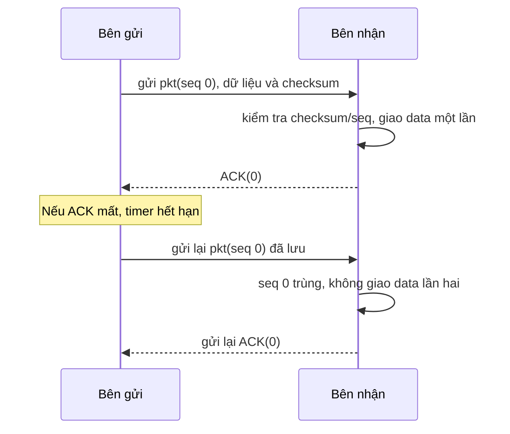

# Reliability Design - Lab 2

**Bản trình bày slide-only để nhóm phản biện.**
**Cơ chế nhóm đề xuất:** RDT 3.0 stop-and-wait từ bài giảng CO3093. Đây là draft thiết kế, chưa phải quyết định cuối cùng hay yêu cầu phải lập trình.
**Owner dự kiến:** REL-01 Nguyễn Đăng Gia Đạo và REL-02 Nguyễn Đổng Thiên Kỳ; cả hai vẫn TENTATIVE.

## 1. Reliability là gì?

Kênh truyền có thể làm packet bị hỏng hoặc bị mất. Reliability là cách sender và receiver phát hiện tình huống đó, xác nhận packet nhận đúng và gửi lại khi chưa có ACK. Nhóm chọn cơ chế RDT 3.0 stop-and-wait làm bản draft dễ trình bày; bài giảng cho biết cách này đơn giản nhưng có thể làm hiệu năng kênh thấp.

## 2. Sender và Receiver làm gì?

1. Sender gắn sequence number 0 hoặc 1 và checksum vào packet, gửi một packet rồi bật timer.
2. Receiver kiểm tra checksum và sequence number đang chờ. Nếu hợp lệ, receiver giao data một lần và gửi ACK mang đúng sequence number.
3. ACK hợp lệ tới sender thì sender dừng timer, đổi 0/1 và mới gửi packet kế tiếp.
4. Nếu packet hoặc ACK mất/trễ, timer hết hạn và sender gửi lại chính packet đang lưu với cùng sequence number.
5. Nếu receiver gặp packet trùng, receiver không giao data lần hai và gửi lại ACK của packet nhận đúng gần nhất.

Slide gọi timeout là khoảng chờ “hợp lý” nhưng không cho một giá trị mili-giây; draft không tự đặt con số.

## 3. Sơ đồ nhóm vẽ lại từ RDT 3.0

Sơ đồ dùng ví dụ ACK bị mất để cho thấy timer và duplicate sequence number hoạt động ra sao. Đây là hình nhóm rút gọn từ slide, không phải hình nguyên bản của giảng viên.

## 4. Hai ví dụ trong slide

- **Hoạt động bình thường - slide 63(a):** sender gửi pkt0 và nhận ACK0, rồi gửi pkt1 và nhận ACK1.
- **Có lỗi - slide 63(b), 64(c):** khi pkt1 mất, timer làm sender gửi lại pkt1; khi ACK1 mất, sender cũng gửi lại pkt1. Receiver nhận ra sequence number trùng và không giao data lần hai, rồi gửi ACK1 lại.

## 5. Ưu điểm và hạn chế

**Ưu điểm theo slide:** checksum giúp phát hiện lỗi, timer giúp xử lý packet mất, sequence number giúp nhận ra packet gửi trùng. (Slide 47-48, 53, 56, 59-62.)

**ĐỀ XUẤT của nhóm:** chọn stop-and-wait vì ít bước, dễ trình bày.

**Hạn chế theo slide:** sender chờ ACK trước khi gửi packet tiếp theo nên hiệu năng thấp; timeout quá sớm có thể gây gửi trùng khi packet/ACK chỉ bị trễ. (Slide 60, 64(d), 67.)

## 6. Phân công và phần chờ xác nhận

- **Gia Đạo - Part 1:** checksum, sequence number 0/1, ACK xác nhận packet nào và cách receiver loại packet trùng.
- **Thiên Kỳ - Part 2:** timer, retransmission cùng sequence number, mất packet/ACK và ví dụ timeout.
- **Cả hai:** xác nhận stop-and-wait có phù hợp dù phải chờ ACK (slide 67), chọn timeout hợp lý vì slide không cho số mili-giây (slide 60), và quyết định có cần data hai chiều. Dùng cặp sender/receiver riêng cho chiều ngược là **ĐỀ XUẤT**. Phân công và cơ chế vẫn chờ sinh viên tự review.

## 7. Nguồn

- **Slide giảng viên:** `Chapter 3_ Transport Layer - Chapter_3_v9.0.pptx`, Chapter 3: slides 45, 47-48, 53, 56-64, 66-67 (footer ghi `Transport Layer: 3-n`). PDF cùng bài giảng có các trang tương ứng.
- **Email Lab 2:** Email A/B trích trong `docs/requirements-matrix.md`, mục 1, rows 10-13: cần draft Reliability/Flow Control/Congestion Control; Steam và QUIC là ví dụ, không phải yêu cầu implement.
- Các ví dụ và thuật toán ở trên theo nội dung slide. RDT 3.0 là cơ chế nhóm đề xuất để đáp ứng yêu cầu draft.
