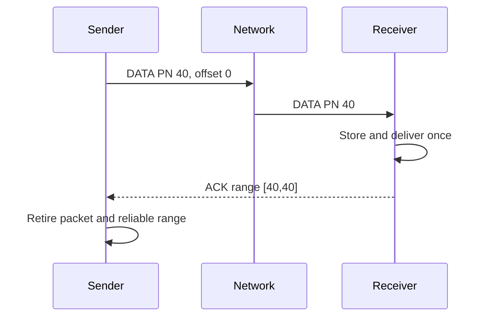
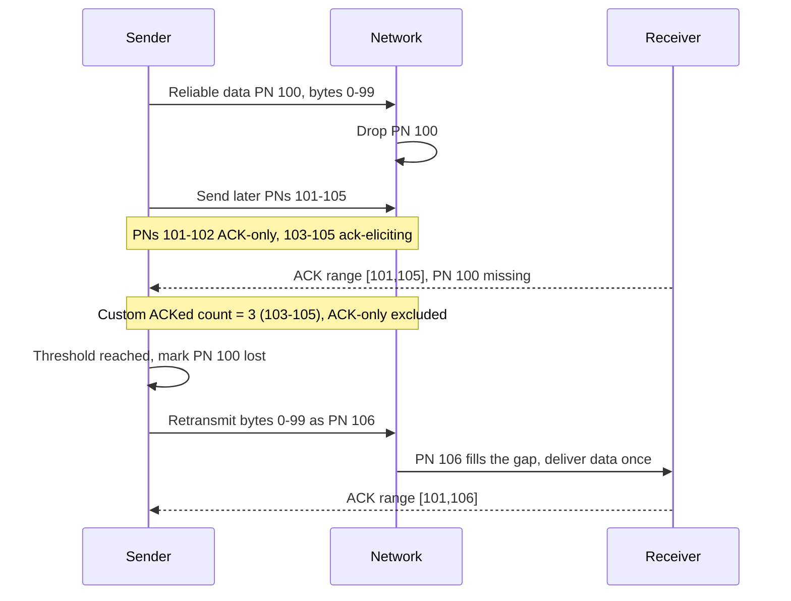

# Reliability Design - Lab 2

**Bản trình bày ngắn để nhóm phản biện.**  
**Trạng thái:** AI_DRAFT_COMPLETE; TECHNICAL_REVIEW_PENDING; TEAM_DECISION_PENDING.  
**Owner dự kiến:** REL-01 Nguyễn Đăng Gia Đạo và REL-02 Nguyễn Đổng Thiên Kỳ, cả hai vẫn TENTATIVE.

## 1. Problem Statement

Một phiên streaming có dữ liệu cần giao đủ và đúng thứ tự, như cấu hình hoặc lệnh điều khiển. Cũng có dữ liệu thời gian thực, như trạng thái game/media, mà bản mới thường có ích hơn việc gửi lại bản cũ.

Nếu mất một gói, sender cần biết lúc nào có đủ bằng chứng để phục hồi. Nếu ACK bị mất, sender không được khiến ứng dụng xử lý cùng lệnh hai lần. Nếu gói đến sai thứ tự, receiver cần giữ dữ liệu trong giới hạn bộ nhớ và chỉ giao đúng thứ tự trong kênh yêu cầu ordered delivery.

Đây là draft do nhóm thảo luận. Email môn học yêu cầu thiết kế nháp Reliability, Flow Control và Congestion Control; không xác nhận rằng Lab 2 bắt buộc dùng QUIC hoặc implement đủ thuật toán.

## 2. Proposed Solution

Đề xuất một cơ chế kiểu Selective Repeat ở mức ứng dụng:

- Mỗi packet có một packet number mới theo từng chiều gửi.
- Reliable data có channel và byte offset riêng; offset giữ nguyên khi retransmit.
- Receiver báo các PN đã nhận bằng ACK ranges; range có thể chứa PN của ACK-only packet khi ACK được gửi vì traffic khác.
- Sender chỉ retransmit reliable byte range còn outstanding, trong packet number mới.
- Real-time update dùng sequence mới; update cũ hoặc đã mất không được retransmit.
- Ordered delivery chỉ áp dụng trong từng reliable channel. Một gap chặn channel đó, không mặc định chặn mọi channel khác.

Packet number và byte offset trả lời hai câu hỏi khác nhau. Packet number nhận diện một lần gửi. Offset nhận diện dữ liệu. ACK một packet cho biết transport đã nhận packet, không chứng minh ứng dụng đã commit lệnh. Nếu cần xác nhận nghiệp vụ, ứng dụng phải có response hoặc command ID/idempotency riêng.

## 3. Packet / ACK Design

| Trường | Vai trò |
|---|---|
| connection_id, packet_number, type/flags | Nhận diện phiên, lần gửi và loại packet |
| ACK frame | Largest acknowledged PN, các range nhận được, ACK delay |
| Reliable frame | channel_id, stream_offset, length, message boundary, payload |
| Real-time frame | channel_id, update_sequence, freshness metadata, payload |
| Receive-credit frame | Giới hạn absolute offset mà receiver còn cho phép |

ACK ranges có thể là [105,106] và [101,102]. Khoảng trống 103-104 cho thấy sender chưa thấy ACK cho chúng, nhưng chưa đủ để kết luận mất. ACK-only packet không yêu cầu ACK ngược lại để tránh vòng lặp. Receiver gửi ACK nhanh khi packet ack-eliciting mới làm lộ gap; trường hợp bình thường, gửi sau hai packet ack-eliciting hoặc khi hết ACK delay đã thống nhất.

## 4. Sender / Receiver Algorithm

1. Sender đóng gói dữ liệu với offset hoặc update sequence; kiểm tra receive credit, congestion budget và pacing.
2. Sender gán packet number mới và lưu thời gian gửi, bytes in flight, cùng byte ranges trong packet.
3. Receiver lọc packet trùng theo packet number. Với packet mới, receiver buffer reliable range trong receive credit và giao message hoàn chỉnh từ offset liên tục tiếp theo.
4. Receiver ghi nhận mọi PN đã xử lý, kể cả ACK-only; gửi ACK cho ack-eliciting traffic theo policy đã chọn.
5. Sender cập nhật ACK/RTT rồi mới chạy loss detection. Packet-count rule riêng của draft là 3 later ACKed ack-eliciting packets, không phải raw PN distance của QUIC.
6. Nếu later ACK đến trước time threshold, sender đặt `loss_time` và re-check khi timer hết, dù không có ACK mới. Dùng `max(9/8 * max(smoothed_rtt, latest_rtt), 1 ms)`.
7. Loss-time timer được ưu tiên. Chỉ khi không có `loss_time` mới chạy PTO; PTO gửi probe nhưng không tự đánh dấu packet cũ lost.
8. Khi loss đã được xác nhận, sender chỉ gửi lại reliable range còn cần. Real-time update đã cũ thì bỏ.

## 5. Hai sơ đồ chính

## 6. Worked Examples

**Threshold comparison.** PN 100 is lost; later ACK-only PNs 101 and 102 arrive before ack-eliciting PN 103. If ACK [101,103] arrives before the time deadline, QUIC's raw-distance test can meet `103 >= 100 + 3`; the numeric distance includes two sent ACK-only PNs, while this draft counts only one later ACKed ack-eliciting packet. Its custom count is 1, so the rules differ and are not equivalent. Two more later ack-eliciting ACKs would reach this draft's count of 3.

**Lost ACK example.** Receiver gets PN 60, stores and delivers its command once, then its ACK is lost. On PTO, sender sends a probe; PTO alone does not mark PN 60 lost. Receiver's next ACK can report both PNs. Offset deduplication prevents a second delivery if a retry was already sent.

## 7. Advantages / Limitations

**Advantages:** one lost packet does not require replaying every later packet; ACK ranges communicate reordering; independent channels can progress; stale real-time data is not forced through a reliable retry queue.

**Limitations:** sender and receiver keep packet, ACK-range, and stream-range state; a time threshold can still misclassify heavy reordering; ordered delivery still blocks within the affected channel; clock-based expiry needs an agreed clock model; exactly-once side effects across crashes require application support. Authentication, encryption, handshake security, and interoperable wire encoding are outside this draft.

## 8. Integration Notes

- **Flow Control:** Reliability supplies channel offsets, newly received ranges, and next contiguous delivery offset. Out-of-order bytes consume receiver buffer and credit. A retransmission reuses an already-authorized offset.
- **Congestion Control:** Reliability reports packet ACKs, confirmed loss, loss-time expiry, RTT samples, PTO probes, retransmission mapping, packet sizes, and bytes-in-flight changes. A PTO is not a loss event. Retransmissions use the same path budget.
- The two existing component designs remain unchanged; the pairs must confirm these interfaces together.

## 9. Pending Team Decisions

- Confirm the tentative REL-01/REL-02 owners and the per-channel ordering model.
- Confirm whether command IDs or application-level acknowledgments are needed.
- Agree on ACK delay, buffer/range caps, update expiry clock, and the no-progress retry cap. The five-PTO example in the detailed draft is an assumption, not a standard.
- Ask Congestion Control whether ACK-only packets count toward its path budget.
- Ask Flow Control whether connection-level and per-channel limits both apply.
- Keep the Assignment 1 TCP/UDP, group-size, and HoL conflicts open; they do not settle Lab 2 scope.

## 10. References and presentation plan

[RFC 9000 sections 12.3 and 13.2-13.3](https://www.rfc-editor.org/rfc/rfc9000.html) informs packet numbering, ACK ranges, and retransmission of information in new packets. [RFC 9002 sections 5, 6.1.1-6.2, and Appendix A.8-A.10](https://www.rfc-editor.org/rfc/rfc9002.html) informs RTT, the QUIC raw-distance threshold, time-loss timer, and PTO. [RFC 9221 section 5](https://www.rfc-editor.org/rfc/rfc9221.html) provides an example of unreliable datagrams that are not retransmitted but remain within congestion control. [Valve GameNetworkingSockets](https://github.com/ValveSoftware/GameNetworkingSockets/blob/master/src/steamnetworkingsockets/clientlib/SNP_WIRE_FORMAT.md) documents reliable message segments and ACK blocks. These are technical references; none means the instructor required QUIC or Valve's wire format.

**Gợi ý nói trong 3-5 phút:** (1) nêu hai loại dữ liệu; (2) phân biệt packet number và stream offset; (3) giải thích ví dụ ACK-only cho thấy packet-count rule khác QUIC raw distance; (4) đi theo sơ đồ loss → threshold → PN mới → giao một lần; (5) nêu giới hạn HoL và quyết định cần nhóm chốt.
