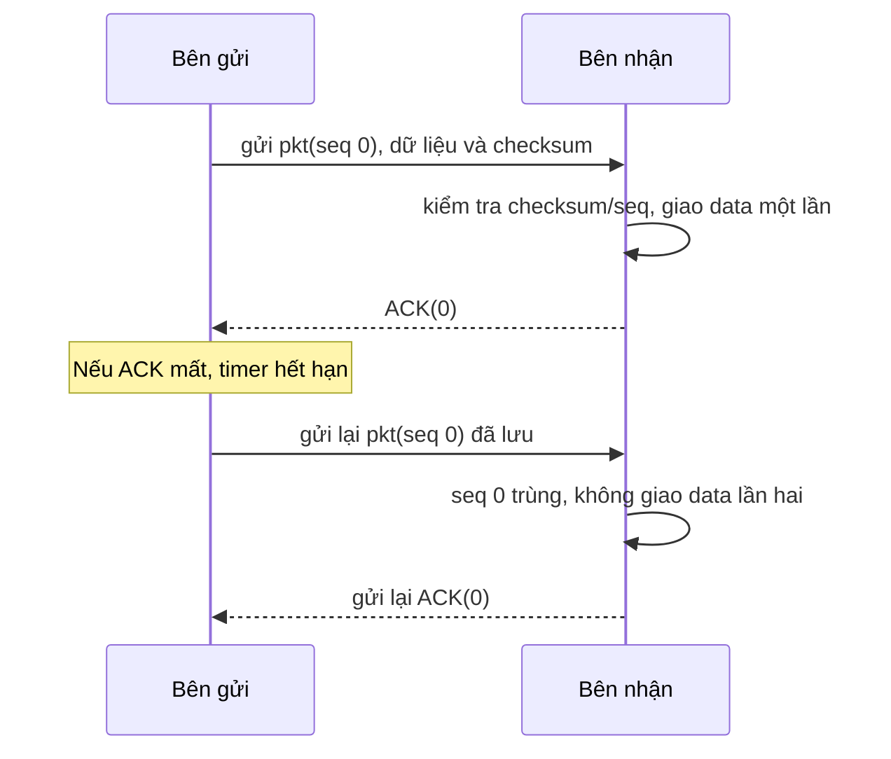

# Reliability - bản slide-only cho CO3094 Lab 2

**Trạng thái:** draft để hai sinh viên tự review; chưa được xác nhận.
**Cơ chế nhóm đề xuất:** RDT 3.0 stop-and-wait, từ slide Transport Layer.

## 1. Reliability là gì?

Reliability giúp sender và receiver chuyển dữ liệu đúng khi kênh có thể làm hỏng hoặc làm mất packet. Bài giảng minh họa RDT 3.0 bằng checksum, sequence number, ACK và timer. (Slide 45, 59-60.)

## 2. Nhóm đề xuất cách hoạt động nào?

**ĐỀ XUẤT:** dùng RDT 3.0 stop-and-wait làm bản draft Reliability; đây là lựa chọn của nhóm từ bài giảng, không phải thuật toán Lab 2 bắt buộc.

1. Sender gắn sequence number 0 hoặc 1 và checksum vào packet, gửi một packet rồi bật timer. (Slide 48, 61.)
2. Receiver kiểm tra checksum và sequence number đang chờ. Nếu packet hợp lệ, receiver giao data một lần và gửi ACK mang đúng sequence number. (Slide 57-58.)
3. Nếu packet lỗi hoặc là bản gửi trùng, receiver không giao data thêm lần nữa; receiver gửi lại ACK của packet nhận đúng gần nhất. (Slide 53, 58.)
4. Sender chỉ tiến tiếp khi nhận ACK không lỗi cho đúng sequence number đang chờ; sender dừng timer, đổi 0/1 rồi gửi packet tiếp theo. (Slide 61-62.)
5. Nếu packet hoặc ACK bị mất/trễ, timer hết hạn và sender gửi lại chính packet đã lưu với cùng sequence number. (Slide 60-62.)

Slide gọi timeout là khoảng chờ “hợp lý” nhưng không quy định số mili-giây. Bản draft không tự thêm một giá trị. (Slide 60.)

### Sơ đồ nhóm vẽ lại từ RDT 3.0

Đây là cách nhóm vẽ lại nhánh ACK bị mất trong slide 64(c), không phải hình nguyên bản của giảng viên.

## 3. Hai ví dụ từ slide

- **Bình thường - slide 63(a):** sender gửi pkt0 và nhận ACK0, rồi gửi pkt1 và nhận ACK1.
- **Có lỗi - slide 63(b), 64(c):** pkt1 mất thì timer làm sender gửi lại pkt1. Nếu ACK1 mất sau khi receiver đã nhận pkt1, sender cũng gửi lại; receiver nhận ra packet trùng, không giao data lần hai và gửi ACK1 lại.

## 4. Ưu điểm và hạn chế

**Ưu điểm theo slide**
- Checksum và ACK giúp receiver phát hiện lỗi; timer giúp sender gửi lại data packet khi packet hoặc ACK bị mất. (Slide 47-48, 59-62.)
- Sequence number giúp receiver nhận ra packet gửi trùng. (Slide 53, 56, 64.)

**ĐỀ XUẤT của nhóm:** dùng stop-and-wait vì ít bước, dễ trình bày.

**Hạn chế**
- Sender chờ ACK trước khi gửi packet tiếp theo; slide 67 cho thấy stop-and-wait làm giảm hiệu năng.
- Timeout quá sớm có thể gây gửi trùng khi packet/ACK chỉ bị trễ. (Slide 60, 64(d).)

## 5. Phân công dự kiến

- **Gia Đạo - Part 1:** checksum, sequence number 0/1, ACK xác nhận packet nào và cách receiver loại packet trùng.
- **Thiên Kỳ - Part 2:** timer, gửi lại packet đã lưu với cùng sequence number, packet/ACK loss và ví dụ timeout.
- **Cả hai:** xác nhận RDT 3.0 stop-and-wait có phù hợp dù phải chờ ACK (slide 67), và chọn timeout hợp lý cho demo (slide 60 không cho con số). Nếu cần data hai chiều, dùng một cặp sender/receiver riêng cho chiều ngược là **ĐỀ XUẤT**; slide chỉ xây dựng data transfer một chiều với control hai chiều. (Slide 45.)

## 6. Nguồn

- **Slide giảng viên:** `Chapter 3_ Transport Layer - Chapter_3_v9.0.pptx`, Chapter 3, slides 45, 47-48, 53, 56-64, 66-67 (footer `Transport Layer: 3-n`). Bản PDF cùng bài giảng có các trang tương ứng.
- **Yêu cầu Lab 2:** Email A/B trích trong `docs/requirements-matrix.md`, mục 1: cần draft Reliability/Flow Control/Congestion Control; Steam và QUIC là ví dụ, không phải yêu cầu implement. Đây là trích đoạn email người dùng đã cung cấp; mailbox gốc chưa được mở độc lập.
- RDT 3.0 là cơ chế nhóm chọn từ bài giảng để làm draft; lựa chọn này vẫn chờ hai sinh viên xác nhận.
